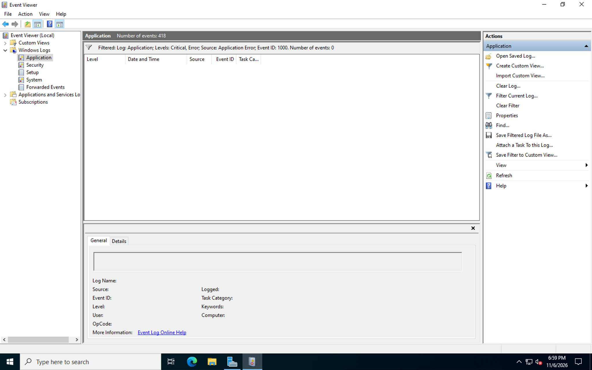

# Windows Event Viewer — Application Crash Troubleshooting Lab

## Project Overview

In this hands-on lab, I simulated a Windows application crash and investigated the resulting error using Windows Event Viewer, PowerShell, and Windows Error Reporting (WER).

The objective was to practice a structured troubleshooting process similar to what IT Support Technicians, Desktop Support Specialists, and System Administrators use when diagnosing application failures in enterprise Windows environments.

I established a baseline, generated a controlled application failure, identified the corresponding Windows event, and configured crash dump collection to preserve diagnostic evidence.

## Technologies Used

- Windows Server / Windows Client
- Microsoft Azure (virtual machine infrastructure)
- Windows Event Viewer
- Windows PowerShell
- Windows Error Reporting (WER)
- Windows Registry
- Application crash dump files (.dmp)
- CSV log exports

## Lab Environment

| Component | Configuration |
|---|---|
| Environment | Windows virtual machine hosted in Microsoft Azure |
| Computer | aDClient01.lab.local |
| Domain | lab.local |
| Application | CrashTest.exe |
| Event Log | Windows Logs → Application |
| Event ID | 1000 — Application Error |
| Working Directory | C:\EventViewer-Lab |
| Crash Dump Directory | C:\EventViewer-Lab\Dumps |

## Investigation Process

### Step 1 — Establish a Baseline

Before introducing the simulated failure, I opened Windows Event Viewer and filtered the Application log for Event ID 1000.

The initial investigation returned zero matching events.

This established a baseline for comparing Windows application behavior before and after the controlled crash.



### Step 2 — Export Baseline Logs Using PowerShell

I used PowerShell to query Windows application crash events and export the results to a CSV file.

```powershell
Get-WinEvent -FilterHashtable @{
    LogName = 'Application'
    ProviderName = 'Application Error'
    Id = 1000
} -ErrorAction SilentlyContinue |
Export-Csv "C:\EventViewer-Lab\Baseline-Crashes.csv" -NoTypeInformation
```

The baseline export contained no matching crash events.

This demonstrated how PowerShell can support repeatable log collection and troubleshooting documentation.


### Step 3 — Simulate an Application Crash

I created a small test executable named `CrashTest.exe` and executed it inside the Windows virtual machine.

The application intentionally generated an unhandled exception to simulate an application failure.

```powershell
& "C:\EventViewer-Lab\CrashTest.exe"
```

This allowed me to reproduce the failure in a controlled environment and investigate the resulting Windows diagnostic information.


### Step 4 — Investigate Event ID 1000

After triggering the application failure, I opened Windows Event Viewer and navigated to:

**Windows Logs → Application → Filter Current Log → Event ID 1000**

I identified an Application Error event associated with the test executable.

#### Event Details

| Field | Observed Value |
|---|---|
| Event ID | 1000 |
| Event Source | Application Error |
| Event Level | Error |
| Faulting Application | CrashTest.exe |
| Application Path | C:\EventViewer-Lab\CrashTest.exe |
| Exception Code | 0x80131623 |
| Faulting Module | Unknown |
| Computer | aDClient01.lab.local |

The event confirmed that Windows recorded the simulated application failure.

I examined the faulting application, exception code, application path, and event timestamp to correlate the event with the test.

The exception code was captured as diagnostic evidence. Determining its precise underlying cause would require further debugging.


### Step 5 — Configure Windows Error Reporting and Capture a Crash Dump

To collect additional diagnostic evidence, I configured Windows Error Reporting to generate a full user-mode crash dump for the test application.

The configuration included:

- **DumpFolder:** `C:\EventViewer-Lab\Dumps`
- **DumpCount:** `3`
- **DumpType:** `2` (Full dump)

After reproducing the application failure, I verified the dump file using PowerShell.

```powershell
Get-ChildItem "C:\EventViewer-Lab\Dumps" |
Select-Object Name, Length, LastWriteTime
```

#### Crash Dump Evidence

| Property | Result |
|---|---|
| File | CrashTest.exe.5336.dmp |
| Size | 69,643,509 bytes (approximately 66.4 MiB) |
| Timestamp | November 6, 2026, 7:45 PM |
| Directory | C:\EventViewer-Lab\Dumps |

The generated dump confirmed that Windows Error Reporting successfully captured additional diagnostic data associated with the application failure.

The dump was preserved for potential analysis with Windows debugging tools. Full dump analysis was outside the scope of this exercise.


## Investigation Findings

| Investigation Stage | Finding |
|---|---|
| Baseline | Zero matching Event ID 1000 records |
| Failure Simulation | Controlled application exception generated |
| Event Investigation | Application Error, Event ID 1000 identified |
| Affected Application | CrashTest.exe |
| Exception Code | 0x80131623 |
| Evidence Collection | Full crash dump generated |
| Root Cause | Intentional failure in the test application; detailed exception analysis not performed |

## Troubleshooting Methodology

This lab followed a structured troubleshooting workflow:

1. **Identify:** Establish the system baseline and define the issue.
2. **Reproduce:** Generate the application failure in a controlled environment.
3. **Investigate:** Review Windows application logs and identify relevant event details.
4. **Collect evidence:** Export event records and capture crash dump information.
5. **Verify:** Confirm that the expected event and dump file were generated.
6. **Document:** Record observations, commands, and findings for future reference.

## Skills Demonstrated

- Windows Event Viewer troubleshooting
- Windows Application Error analysis
- PowerShell event log queries and CSV exports
- Application failure reproduction
- Windows Error Reporting configuration
- Windows Registry configuration
- Crash dump collection and verification
- Technical documentation
- Structured troubleshooting and evidence collection

## Key Takeaways

This project strengthened my ability to investigate Windows application failures using built-in administrative tools.

I gained practical experience identifying application crash events, correlating log entries with observed failures, and collecting diagnostic evidence that could support further troubleshooting or escalation.

In an enterprise IT environment, these skills can help support application troubleshooting, incident documentation, and escalation to senior technical teams.

## Future Improvements

- Analyze the crash dump using WinDbg.
- Correlate Event ID 1000 with related Windows Error Reporting events.
- Investigate real application failures and compare exception patterns.
- Document a complete troubleshooting ticket with escalation notes.
- Practice resolving service crashes and verifying application recovery.

---

**Project Type:** Windows Endpoint Troubleshooting / IT Support Lab

**Focus Areas:** Windows Administration | PowerShell | Event Viewer | Application Troubleshooting | Diagnostic Evidence Collection
